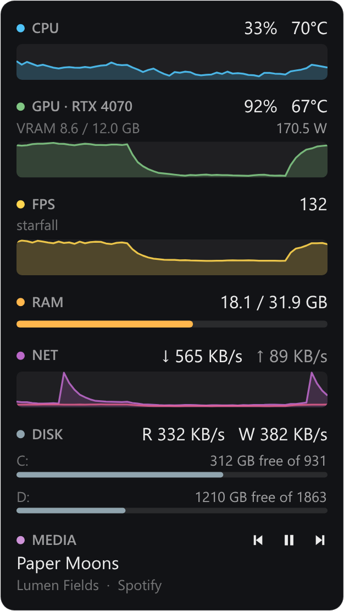
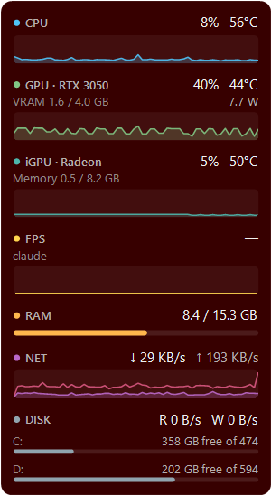
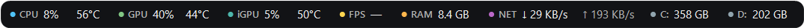
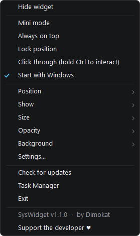
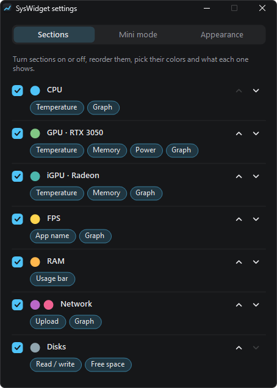

# SysWidget

A tiny, native system-monitor widget for Windows. One small exe, no runtimes to install, ~0.03% CPU.

[Download](https://github.com/Dimokat/SysWidget/releases/latest) · [Support the project](https://send.monobank.ua/jar/125L2LfHgy)

**CPU** load & temperature · **GPUs** (every one, integrated too) load, memory, temperature & power · **FPS** of the app in front · **RAM** · **Network** up/down · **Ping** · **Disks** activity & free space · **Battery** · **Now playing** with play/pause

<p align="center">
  &nbsp;&nbsp;
  
</p>

<p align="center"></p>

## Install

1. Download **SysWidget-vX.Y.Z.zip** from the [latest release](https://github.com/Dimokat/SysWidget/releases/latest).
2. Extract it and run **Setup.exe** from the **SysWidget** folder inside. Windows SmartScreen may say *"Windows protected your PC"* because the files aren't code-signed: click **More info → Run anyway**.
3. Keep **Start with Windows** checked. It also enables the FPS counter.

If Microsoft Defender flags it (a `Wacatac!ml`-style detection), that's a machine-learning false positive on new, unsigned software: allow it under *Windows Security → Protection history*. All the source and the automated build are in this repo.

Uninstall from *Settings → Apps*, or run the setup again and pick **Uninstall**.

Requires Windows 10 or 11 (uses the .NET Framework that ships with Windows). Every GPU shows load and memory. Temperature comes from the NVIDIA and AMD drivers, power from NVIDIA and AMD graphics cards (Intel GPUs show load and memory only).

## Using it

| Action | What it does |
|---|---|
| Drag | Move it. It snaps to screen edges and docks to them. |
| Double-click | Open Task Manager |
| Right-click | Menu: Hide widget, Mini mode, Always on top, Lock position, Mouse over the widget, Position, Show, Settings, How to use |
| Point at CPU or RAM | A small list of the apps using the most CPU or memory |
| Ctrl + mouse | Interact with it while it lets clicks through or hides under the cursor (*Mouse over the widget* in the menu). With *Hide under cursor*, the widget fades away while the mouse is over it and clicks go to whatever is underneath; holding Ctrl brings it back. |
| Ctrl + Alt + W / Ctrl + Alt + M | Hide or show the widget / switch mini mode, from any app (can be turned off in Settings) |
| Tray icon | Left-click hides/shows the widget, right-click opens the same menu, hover shows a quick summary |

- **Mini mode** turns it into a single line of stats. By default it's an *island*: point at a stat and it grows into a card with more (graphs, the busiest apps, album art with play/pause and skip buttons), then shrinks back when the mouse leaves. It also opens for a few seconds when the song changes. With click-through on, hold Ctrl to use it. *Settings → Mini mode* can switch it to the classic strip. Docked to the left or right edge of the screen, mini mode becomes a column of small tiles (and the island's cards slide out sideways); this can also be fixed to a row or a column there.
- **Hide widget** (or a left-click on the tray icon) tucks it away while it keeps running in the tray. Starting SysWidget again brings it back.
- **Show** turns individual sections on and off. Hidden sections aren't polled at all. **Ping** and **Now playing** start off; turn them on here.
- **Settings** has everything else, and changes apply as you make them:
  - *Sections* and *Mini mode*: order, colors and what each section shows (temperature, memory, power, graph...).
  - *Appearance*: normal or compact layout, a dark, Windows accent color or light background, filled / line / bar graphs, size, opacity, language.
  - *General*: Start with Windows, update checks, keyboard shortcuts, what to do when a fullscreen game or video is in front (nothing, switch to mini, hide), update interval, graph length, °C or °F, network speed in MB/s or Mb/s, the ping server, and exporting or importing your settings.
  - *Alerts*: a Windows notification when the CPU or GPU stays too hot, RAM too full or a drive nearly full.
- **Now playing** shows what's playing in Spotify, a browser or any other player, with previous / play-pause / next buttons.
- While a window or a fullscreen app covers the widget, it stops drawing (it keeps measuring), so it costs even less.
- It checks this repo's releases for updates (about once every 6 hours) and shows a small yellow dot plus an *Update to vX.Y.Z now* menu item when there is one. One click downloads the release, checks it against the SHA-256 in the release notes, installs it with your current choices and restarts SysWidget; your settings stay. You can turn update checks off in Settings.
- **How to use** in the menu shows all of this on one page. It also opens once on first start.

<p align="center">
  &nbsp;&nbsp;
  
</p>

### About the FPS counter

FPS is read from Windows' own graphics event tracing (the same source PresentMon uses). Nothing is injected into games, so it's safe with anti-cheat. Windows only allows this for programs running as admin, which is why it relies on **Start with Windows** (a scheduled task with highest privileges, so there's no UAC prompt at login).

In true *exclusive* fullscreen no normal window can be drawn over a game. Use borderless/windowed fullscreen to see the widget in-game, or turn on **Settings → General → Show in games through RivaTuner**: SysWidget then hands the Mini mode sections to [RivaTuner Statistics Server](https://www.guru3d.com/download/rtss-rivatuner-statistics-server-download/) (it comes with MSI Afterburner), which shows them in games' on-screen display, exclusive fullscreen included. SysWidget itself still never touches the game; which games show the overlay is set in RivaTuner.

## Languages

SysWidget follows your Windows display language (*Settings → Time & language → Language & region*), and you can pick another one in **Settings → Appearance → Language**. Numbers follow your Windows regional format.

Built in: English · Українська · Русский · Polski · Čeština · Română · Magyar · Deutsch · Nederlands · Français · Español · Italiano · Português (Brasil) · Português (Portugal) · Türkçe · 日本語 · 한국어 · 中文 (简体) · 中文 (繁體) · Tiếng Việt · Bahasa Indonesia

Any other language shows English.

**Helping with translations.** Translations are plain text files in [`lang/`](lang). To fix one or add a language, edit or add `lang/<code>.txt` and open a pull request; [lang/README.md](lang/README.md) explains the format. Once it's merged, SysWidget downloads it from this repository on its next update check (while **Check for updates** is on), so it reaches people without a new release.

## Building

No IDE or SDK needed. Run **build.bat**. It takes the version from the latest git tag and uses the C# compiler that's built into Windows (`csc.exe` from .NET Framework 4.x) and produces `SysWidget.exe` and `Setup.exe`.

## Releasing

Push a version tag and GitHub Actions builds both programs and publishes a release with a zip of `SysWidget.exe` + `Setup.exe` and their SHA-256 hashes:

```
git tag v1.1.0
git push origin v1.1.0
```

The version inside the programs is set from the tag automatically.

## Support

SysWidget is free and open source. If you find it useful, you can buy me a coffee through a monobank jar (any Visa/Mastercard works):

[](https://send.monobank.ua/jar/125L2LfHgy)


## License

[MIT](LICENSE) © 2026 Dimokat
